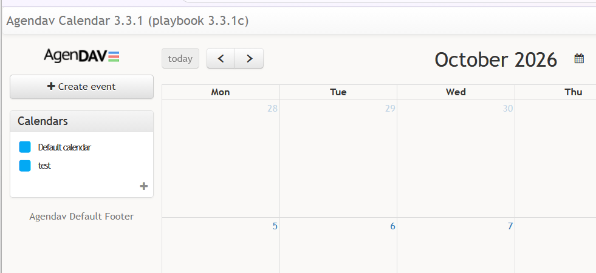

# Agendav-docker

This project generates an agendav 3.3.1 docker image. 

## How to run

```docker
docker run -d \
  --name agendav \
  --restart unless-stopped \
  --network agendav_mariadb_network \
  -p 8080:8080 \
  -e AGENDAV_CALDAV_PUBLIC_URL="127.0.0.1:8081" \
  -e AGENDAV_CALDAV_SERVER="http://baikal/cal.php/" \
  -e AGENDAV_CSRF_SECRET="dcbde2db80e327aa0321bcfcdfbbbfd1d32df129d055675ea91ec50ccd111648" \
  -e AGENDAV_DB_DATABASE="agendav" \
  -e AGENDAV_DB_HOST="mariadb" \
  -e AGENDAV_DB_PASSWORD="agendav_db_password" \
  -e AGENDAV_DB_USER="agendav" \
  -e AGENDAV_ENVIRONMENT="dev" \
  -e AGENDAV_FOOTER="Agendav Default Footer" \
  -e AGENDAV_LANG="en" \
  -e AGENDAV_LOG_DIR="tmp/" \
  -e AGENDAV_SERVER_NAME="agendav" \
  -e AGENDAV_TIMEZONE="Europe/Paris" \
  -e AGENDAV_TITLE="Agendav Calendar 3.3.1 (playbook v3.3.1b)" \
  -e AGENDAV_WEEKSTART="1" \
  ghcr.io/chris4474/agendav-docker:playbooks-3.3.1
```

**Database:** Name of an **existing** database managed by the specified host with credentials to manage this database.

AGENDAV_DB_HOST=mariadb
AGENDAV_DB_DATABASE=agendav
AGENDAV_DB_USER=agendav
AGENDAV_DB_PASSWORD=agendav_db_password

**Environment**:  Can be `prod` or `dev`. If you are not familiar with how calendar is deployed, make you first attemps with `dev` and access over http.

AGENDAV_ENVIRONMENT=dev

**Agendav Server Name**

AGENDAV_SERVER_NAME=agendav

**Agendav UI**

AGENDAV_TITLE=Agendav Calendar 3.3.1 (playbook v3.3.1b)
AGENDAV_FOOTER=Agendav Default Footer
AGENDAV_TIMEZONE=Europe/Paris
AGENDAV_LANG=en
AGENDAV_WEEKSTART=1


**Caldav server specs**: The caldav server must exists, can be reached at the specified URL and has been populated with users. 

AGENDAV_CALDAV_SERVER=[http://baikal/cal.php/](http://baikal/cal.php/) AGENDAV_CALDAV_PUBLIC_URL=127.0.0.1:8081 # not sure where this one is used

**Miscellaneous**:

AGENDAV_LOG_DIR=tmp/ # I have never change it
AGENDAV_CSRF_SECRET=<  generate with  `openssl rand -hex 32`  >  

## Use with Ansible Playbook

This docker image works best with the following ansible playbook https://github.com/chris4474/agendav-playbooks.

All you have to do before using this playbook is to populate a file which contains passwords and run the playbook. The playbook creates a docker compose file. The docker compose file is then used to deploy  agendav, baikal and a mariadb engine with the databases needed by baikal and agendav.

# Credits

All the credits for the agendav Dockerfiles goes to https://github.com/nagimov. I only adapted it to load agendav 3.3.1 and work with mariadb.
